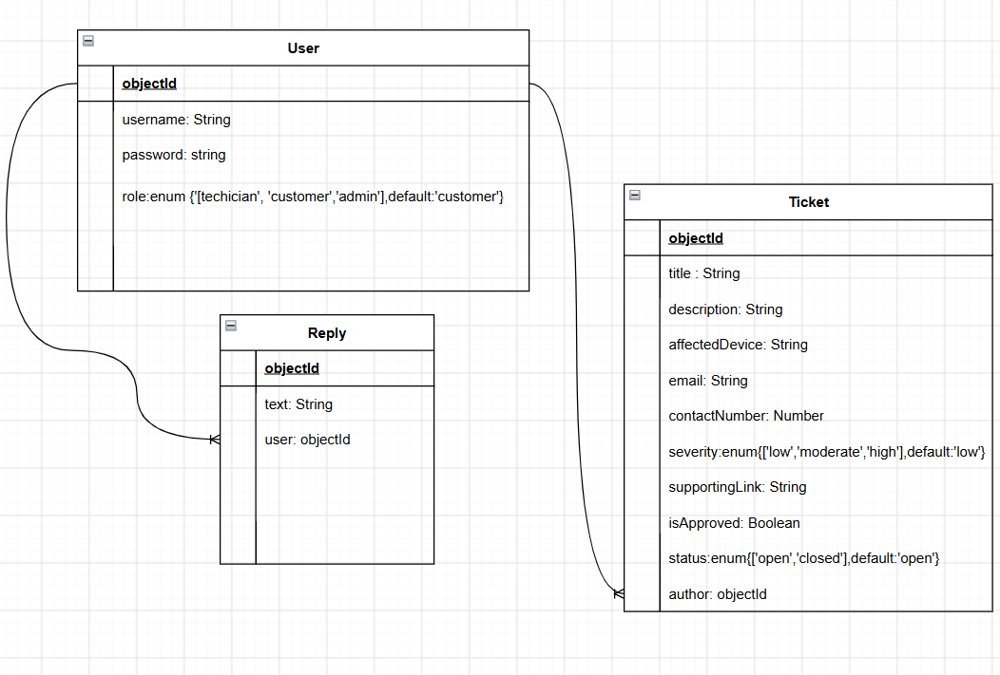

# Project Name Frontend

## Overview

Give quick overview on how it works and how the user can use it

## Live Application

- **Frontend:** Deployed frontend
- **Backend API:** Deployed Backend
- **Backend Repository:** Backend Github Repository

## Screenshots

### Home Page


### Feature Page

### Other pages


## Technologies Used

- React
- Vite
- React Router
- Axios
- CSS or CSS Modules

Only include ones you used on frontend

## Features

- User registration and login
- Protected routes
- etc.


## Project Structure

If you have different structure than this then add or remove from it

```text
src/
├── assets/
├── components/
├── context/
├── pages/
├── services/
├── styles/
├── App.jsx
└── main.jsx
```

## Getting Started

### Prerequisites

Install the following before running the project:

- node.js

The backend API has to be working. LINK TO THE BACKEND API

## Installation

### 1. Clone the repository

```bash
git clone FRONTEND_REPOSITORY_URL
cd FRONTEND_REPOSITORY_NAME
```

### 2. Install dependencies

```bash
npm install
```

### 3. Create the environment file

Create a `.env` file in the root directory:

```env
VITE_BACK_END_SERVER_URL=http://localhost:3000
```

### 4. Start the development server

```bash
npm run dev
```

Go to:

```text
http://localhost:5173
```


## Application Routes

| Route                       | Page              | Access         |
| --------------------------- | ----------------- | -------------- |
| `/`                         | Home page         | Public         |
| `/register`                 | Registration page | Public         |
| `/login`                    | Login page        | Public         |
| `/products`                 | Product list      | Public         |
| `/products/:productId`      | Product details   | Public         |
| `/products/new`             | Create product    | Authenticated  |
| `/products/:productId/edit` | Edit product      | Owner or admin |
| `*`                         | Not-found page    | Public         |

### ERD




## User Stories
1. As a Technicain or Customer , I should be able to create a support ticket.
2. As a Technician, I should be able to view all support tickets.
3. As a customer, I should only be able to view my related support ticket(s).
4. As a Techincian , I should be able to verify / approve a ticket for further action.
5. As a technician , I should be able to close a ticket.
6. As a Technician , I should be able to edit a ticket.
7. As a Technician, I should be able to delete a ticket.
8. As an Admin I should be able to assign roles accordingly , whether it is a Technician or a Customer.
9. As a Technician or Customer, I should be able to post a reply on a ticket.
10. As a Technician or Customer , I should be able to delete my replies.
11. As a Customer , I should be able to post a link to supporting evidence (image or diag file).
12. As a Technician , I should be able to set the priority of the issue.
13. As a Customer , I should be able to specify the affected device/system.
14. As a Customer, I should be able to fill out problem title and summary fields.
15. As a customer, I should be able to fill out contact details.
16. As a Technician or Customer , I should be able to see the time and date that the ticket was created.


## Future Enhancements


## Team Members

| Name         | GitHub           |
| ------------ | ---------------- |
| Student Name | [GitHub profile] |
| Student Name | [GitHub profile] |


## Credits